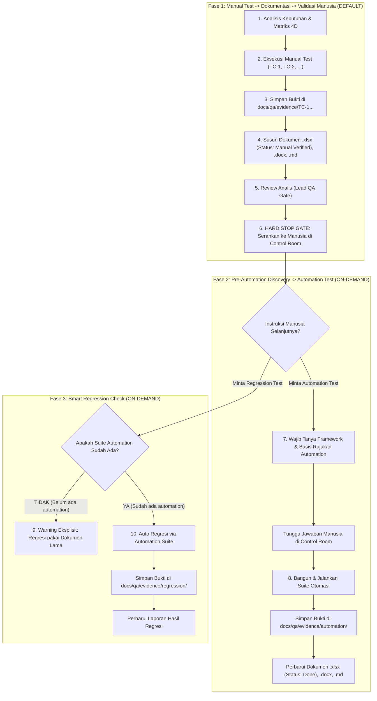

# 🛡️ QA & Test Automation Specialist Protocol (`qa-test-specialist`)

## 1. Context & Business Intent
Dalam arsitektur *Autonomous Software Engineering*, pengujian unit (*unit testing*) internal yang ditulis oleh pengembang (Coder) tidak cukup untuk menjamin kehandalan sistem saat dipanggil dari luar. Perangkat lunak sering kali mengalami kegagalan akibat pergeseran kontrak API (*API contract drift*), penanganan error yang membocorkan data sensitif, mutasi liar pada pemanggilan berulang (*idempotency failure*), serta perebutan sumber daya (*data race* / *concurrency deadlocks*).

Skill **`qa-test-specialist`** menetapkan protokol standar bagi peran **QA Engineer** sebagai **Validation Gatekeeper** independen. Protokol ini memastikan seluruh layanan diuji secara komprehensif pada lingkungan runtime nyata menggunakan **4-Dimensional Test Matrix**, diaudit relevansi lapangannya oleh Analis (Senior Lead Engineer), dan dipetakan triagenya (`AUTO_VERIFIED` vs `HUMAN_VALIDATION_REQUIRED`) sebelum diserahkan ke tahap *User Acceptance Testing (UAT)*.

---

## 2. Pre-requisites & Environment Check
Sebelum memulai tahapan pengujian, QA Engineer wajib memastikan ketersediaan lingkungan dan utilitas berikut:
- [ ] Layanan aplikasi target dapat di-build atau dijalankan di lingkungan lokal/test (`go build`, `npm run build`, dsb.).
- [ ] Endpoint pemeriksaan kesehatan (*Healthcheck probe*) aktif (misal `GET /healthz` atau `GET /actuator/health`).
- [ ] Tersedia tool pendukung otomasi pengujian di PATH:
  - `python3` (untuk menjalankan skrip verifikasi laporan deterministik).
  - `curl` / HTTP client CLI (untuk black-box probing).
  - Bruno CLI (`bru`) atau script runner terkait (jika menggunakan koleksi Bruno).
  - Go toolchain dengan race detector (`go test -race`) jika proyek berbasis Go.
- [ ] Konfigurasi test environment diatur ke mode Sandbox (menggunakan mock, database test, atau kredensial non-produksi).

---

## 3. Strict Operating Rules (Enterprise Constraints)

1. **Strict Git Read-Only Policy**:
   - QA Engineer adalah agen bertipe *Worker*. DILARANG KERAS menjalankan `git add`, `git commit`, `git push`, `git merge`, atau mutasi git lainnya.
   - Seluruh artefak pengujian disimpan di berkas lokal workspace.
2. **Koleksi Terisolasi (Dev vs QA Collection Segregation)**:
   - Dilarang mencampuradukkan koleksi otomasi QA dengan koleksi dev harian milik developer.
   - Seluruh suite otomasi QA disimpan di direktori terdedikasi: `bruno/qa-suite/` atau `tests/qa/`.
3. **Mandatory Analyst Review Loop (Sejajar dengan Coder)**:
   - QA Engineer **WAJIB** mengajukan `tasks/<project_id>/qa-test-report.md` kepada **Analis (Senior Lead Engineer)** untuk diaudit relevansinya dengan kondisi lapangan (*Field-Realism Audit*).
   - Dilarang meloloskan pengujian ke UAT tanpa adanya tanda tangan persetujuan resmi (`APPROVED`) dari Analis di Bagian 7 Laporan QA.
4. **Sandbox Entity Targeting**:
   - Setiap pengujian mutasi (POST, PUT, DELETE) WAJIB menargetkan entitas sandbox/dummy (contoh: ID `test-sandbox-999`, prefix `qa-temp-`, atau query parameter `dry_run=true`).
   - DILARANG memutasi atau menghapus data persisten di luar entitas uji.
5. **Zero Secret Exposure**:
   - Dilarang mencantumkan token otentikasi nyata, kata sandi, atau data PII (Personally Identifiable Information) di dalam laporan markdown atau assertion file. Selalu gunakan placeholder aman.
6. **Framework Confinement**:
   - Dilarang menyentuh atau memodifikasi direktori framework (`cmd/`, `installer/`, `.agents/skills/`).
7. **Master Template Dokumen Organisasi (Specific Domain Pack)**:
   - Jika Active Specific Domain Pack menyediakan master template organisasi (`.agents/domains/<domain_id>/templates/` atau path yang didefinisikan di `domain.yaml`), QA Engineer wajib merujuk pada template domain tersebut:
     - **Baseline Matriks Uji Excel Generik (10 kolom standar default)**: Test ID, Summary, Description, Test Type, Gherkin Definition, Cucumber Test Type, Environment, Expected Result, Reporter, Status Automation (dapat dikustomisasi lewat Specific Domain Pack).
     - **Template Laporan Word Baku (QAD `.docx`)**: Gunakan `doc-tool.py write-qad` yang otomatis membaca `qad-template.docx` dan metadata organisasi dari Active Specific Domain Pack (atau `--template <path.docx>`). Jika domain masih `base` tanpa template berlogo, hasilkan dokumen dengan styling generik yang rapi via `doc-tool.py write`.
   - QA Engineer wajib menggunakan skill `office-document-suite` (`doc-tool write input.md output.docx`) untuk menghasilkan dokumen QAD resmi dan spreadsheet matriks pengujian secara presisi.
8. **Standar Wajib Folder Bukti Pengujian Terisolasi (`docs/qa/evidence/TC-1...`)**:
   - Setiap test case (`TC-1`, `TC-2`, ..., `TC-N`) WAJIB memiliki folder bukti terisolasi di `docs/qa/evidence/TC-1/`, `docs/qa/evidence/TC-2/`, dst.
   - Skenario otomatis/fungsional memuat: `01-request-info.txt`, `02-response-output.json` (atau `.yaml`), dan `03-verification-summary.txt`.
   - Skenario `HUMAN_VALIDATION_REQUIRED` memuat: `README-EVIDENCE-GUIDE.txt` sebagai panduan observasi visual manusia.
9. **Penegakan Tata Kelola 3 Fase Bertahap di Bawah Kendali Manusia**:
   - **Fase 1 (Default)**: Manual Test -> Dokumentasi -> Validasi Manusia (HARD STOP GATE). Dilarang membuat automation tanpa persetujuan manusia.
   - **Fase 2 (On-Demand)**: Pre-Automation Discovery Gate (Wajib Tanya Framework & Basis Rujukan) sebelum membuat script otomasi.
   - **Fase 3 (On-Demand)**: Smart Regression Check (Peringatan cerdas jika diminta regresi saat suite otomasi belum ada, fallback ke dokumen lama).
10. **Pre-QA Evidence & Target Discovery Gate (`qa-targets.yaml` & `qa-evidence-spec.yaml`)**:
   - Sebelum pengujian dimulai, QA Engineer wajib memeriksa target di `qa-targets.yaml` (divalidasi melalui `ui-capture targets --project <id>`) dan kontrak artefak di `qa-evidence-spec.yaml`.
   - Jika target berstatus `NEEDS_HUMAN_URL_CONFIRMATION` atau kontrak evidence belum disahkan manusia (`human_confirmed: false`), agen dilarang keras menebak URL atau membuat evidence seadanya; wajib berkonsultasi dengan manusia di Control Room.
11. **3-Layer Evidence Authenticity & Zero-Vision-Token Protocol**:
   - **Layer 1 (Deteksi Galat Halaman & Validasi Bagian Otomatis)**: Backend `ui-capture shot` menjalankan `validate_page_authenticity` dan `validate_section_target` untuk menolak halaman kesalahan server maupun bagian yang tidak tampak/kosong (`REJECTED_SECTION_*`) dengan Exit Code 4 atau 5.
   - **Layer 2 (Zero-Vision-Token Telemetry First & Conditional Vision)**: Untuk menghemat kuota token hingga 95-100%, QA Engineer dan Analis memvalidasi keabsahan bukti melalui `dom_telemetry` dan `section_validation` pada `capture-log.json` (0 Token Vision!). `read_file` pada `.png` hanya dipanggil jika `vision_check_needed: true` (layar kosong/mencurigakan).
   - **Layer 3 (Deterministic Report & Evidence Verification)**: Skrip `verify-qa-report.py` memvalidasi kelengkapan artefak per TC sesuai `qa-evidence-spec.yaml` dan memblokir laporan jika terdeteksi entri berstatus `REJECTED_*`.

---

## 4. Deterministic 4-Dimensional Test Matrix

Setiap pengujian validasi QA **WAJIB** mencakup dan melaporkan 4 dimensi pengujian secara eksplisit:

| Dimensi Pengujian | Fokus & Kriteria Verifikasi | Folder Bukti (Evidence) | Target HTTP Status / Respon |
|---|---|---|---|
| **1. Skenario Positif (Happy Path)** | Verifikasi alur bisnis normal sesuai Acceptance Criteria pada `01-requirements.md`. Seluruh parameter valid terproses dan payload respons sesuai spesifikasi. | `docs/qa/evidence/TC-1/` ... | `200 OK`, `201 Created`, `204 No Content` |
| **2. Skenario Batas & Negatif (Boundary)** | Menguji batas input: string kosong, string melampaui batas karakter, tipe data salah (string pada integer), field wajib dihilangkan, format email/UUID salah. Pesan error terformat rapi tanpa stack trace. | `docs/qa/evidence/TC-5/` ... | `400 Bad Request`, `404 Not Found`, `422 Unprocessable Entity` |
| **3. Idempotensi & State Preservation** | Menguji pemanggilan berulang (*repeat requests*). Pengujian parameter seperti `only_new=true` (operasi/data eksisting tidak termutasi, hanya data baru yang ditambahkan). Mode `dry_run=true` tidak mengubah state database. | `docs/qa/evidence/TC-9/` ... | Status stabil, state persisten terlindungi, diff akurat |
| **4. Keamanan & Konkurensi (Race Condition)** | Proteksi endpoint privat dari akses tanpa otentikasi (`401 Unauthorized`). Pengujian akses serentak (*concurrent requests*) bebas dari data race (`go test -race` 100% PASS, 0 warning race). | `docs/qa/evidence/TC-11/` ... | `401 Unauthorized` pada unauthenticated, 0 race warning |

---

## 5. Alur Kerja Bertahap Berbasis Kendali Manusia (3-Phase Human-Controlled Lifecycle)



### Fase 1: Manual Test -> Dokumentasi -> Validasi Manusia (HARD STOP GATE)

#### Langkah 1.1: Analisis Kontrak & Penyusunan Matriks Uji
- Baca `tasks/<project_id>/01-requirements.md` dan `tasks/<project_id>/02-technical-spec.md`.
- Identifikasi daftar endpoint, HTTP method, header wajib, parameter query/body, serta aturan validasi bisnis.
- Susun tabel **4-Dimensional Test Matrix** lengkap dengan penetapan folder bukti `docs/qa/evidence/TC-1/` s/d `TC-N/`.

#### Langkah 1.2: Eksekusi Manual Test & Pengumpulan Bukti Terisolasi
- Eksekusi pengujian secara bertahap untuk setiap test case (`TC-1`, `TC-2`, ..., `TC-N`).
- Buat folder terisolasi di `docs/qa/evidence/TC-<ID>/` dan simpan bukti:
  - `01-request-info.txt` (Method, URL, Headers, Payload).
  - `02-response-output.json` atau `.yaml` (Respon aktual dari server).
  - `03-verification-summary.txt` (Status assertion dan kesimpulan).
  - Untuk item `HUMAN_VALIDATION_REQUIRED`: buat `README-EVIDENCE-GUIDE.txt` sebagai panduan screenshot/observasi UAT.
- Jalankan deteksi data race runtime jika relevan (`go test -count=1 -race ./...`).

#### Langkah 1.3: Penyusunan Dokumentasi Manual Test
- Hasilkan dokumen spreadsheet resmi `docs/qa/Test-Cases-and-Defects-<project_id>.xlsx` menggunakan `doc-tool write`:
  - Sheet `Test Case`: 10 kolom standar + kolom `Evidence Folder` (`docs/qa/evidence/TC-*`) + kolom hasil (`Test Status`, `Triage Category`), atau ikuti skema kustom pada Specific Domain Pack jika aktif.
  - Kolom `Status Automation` pada Fase 1 ini diisi **`Manual Verified (Pending Automation)`**.
  - Sheet `List Bugs`: pencatatan defect/temuan (atau defect historis yang telah terverifikasi).
  - Sheet `Matriks Triage UAT`: pemisahan `AUTO_VERIFIED` vs `HUMAN_VALIDATION_REQUIRED`.
  - Sheet `Review Analis & Field Audit`: ringkasan evaluasi skenario lapangan.
- Terbitkan `docs/qa/QA-Validation-Report-<project_id>.docx` dan `tasks/<project_id>/qa-test-report.md`.

#### Langkah 1.4: Pengajuan Review ke Analis (Lead QA Gatekeeping)
- Ajukan `tasks/<project_id>/qa-test-report.md` dan folder bukti `docs/qa/evidence/TC-*` ke **Analis (Senior Lead Engineer)**.
- Analis melakukan audit relevansi lapangan (*Field-Realism Audit*), memverifikasi kelengkapan bukti fisik, dan mengesahkan Matriks Triage Validasi.
- **Jika `NEEDS_QA_REVISION`**: Lengkapi kekurangan skenario/bukti yang diminta Analis dan ajukan kembali.
- **Jika `APPROVED`**: Analis membubuhkan sign-off resmi pada Bagian 7 Laporan QA.
- Validasi laporan dengan skrip deterministik:
  ```bash
  python3 .agents/skills/qa-test-specialist/scripts/verify-qa-report.py tasks/<project_id>/qa-test-report.md
  ```

#### Langkah 1.5: Validasi Manusia (HARD STOP GATE)
- Setelah Fase 1 disetujui Analis, agen **WAJIB BERHENTI (STOP)** dan menyerahkan seluruh hasil pengujian ke Manusia di Control Room.
- **DILARANG KERAS** melompat langsung membuat/menjalankan Automation Test atau Regression Test tanpa instruksi eksplisit dari Manusia!

---

### Fase 2: Pre-Automation Discovery -> Automation Test -> Dokumentasi (ON-DEMAND)

Hanya dijalankan jika Manusia di Control Room secara eksplisit meminta pengujian diotomasi:

#### Langkah 2.1: Pre-Automation Discovery Gate (Aturan Wajib Tanya)
- Sebelum menulis berkas otomasi apa pun, agen **WAJIB BERTANYA kepada manusia**:
  1. *"Ingin menggunakan **framework / tools automation** apa?"* (Opsi: Cucumber/BDD, Bruno CLI, Playwright, Cypress, Newman/Postman, Go/Python runner).
  2. *"Automation ini dibuat **berdasarkan (base on)** apa?"* (Opsi: Berdasarkan repo/boilerplate automation eksisting, atau di-generate dari dokumen `Test Case` & `Gherkin Definition` hasil Fase 1 Manual Test).
- Agen menunggu konfirmasi jawaban dari Manusia di Control Room.

#### Langkah 2.2: Pembangunan Suite Otomasi & Eksekusi
- Bangun koleksi otomasi (misal di `bruno/qa-suite/` atau direktori runner terkait) sesuai jawaban Manusia.
- Eksekusi suite otomasi pengujian runtime.
- Simpan seluruh assertion log dan output di **`docs/qa/evidence/automation/`**.

#### Langkah 2.3: Pembaruan Dokumentasi Automation
- Perbarui `docs/qa/Test-Cases-and-Defects-<project_id>.xlsx`:
  - Isi sheet `Task List Automation` dan `Automation Test Case`.
  - Ubah kolom `Status Automation` pada sheet `Test Case` menjadi **`Done`**.
- Perbarui dokumen `.docx` dan `qa-test-report.md`, lalu catat ke `team-orch log`.

---

### Fase 3: Smart Regression Check (ON-DEMAND)

Hanya dijalankan jika Manusia di Control Room meminta pengujian Regresi:

#### Langkah 3.1: Pengecekan Ketersediaan Suite Otomasi
- **Jika Suite Otomasi BELUM ADA (Fase 2 Belum Dilakukan)**:
  - Agen **WAJIB MEMBERIKAN WARNING EKSPLISIT**:
    > *"⚠️ **PERINGATAN (Belum Ada Automation Test)**: Proyek ini belum memiliki suite Automation Test (Fase 2 belum dijalankan). Oleh karena itu, pengujian regresi akan dilakukan menggunakan **dokumen-dokumen lama (`docs/qa/Test-Cases-and-Defects-<project>.xlsx` dan `docs/qa/evidence/TC-*`)** sebagai acuan validasi regresi. Apakah Anda ingin melanjutkan regresi berbasis dokumen lama ini, atau membangun Automation Test terlebih dahulu?"*
  - Tunggu konfirmasi Manusia sebelum melanjutkan.
- **Jika Suite Otomasi SUDAH ADA**:
  - Jalankan Auto Regresi menggunakan suite otomasi yang telah tersedia.
  - Simpan bukti pengujian di **`docs/qa/evidence/regression/`**.
  - Perbarui laporan hasil uji regresi dan catat ke `team-orch log`.

---

## 6. Output Deliverables
1. `tasks/<project_id>/qa-test-report.md`: Laporan komprehensif 7 bab berstandar enterprise (memuat Matriks Triage Bagian 6 dan Sign-Off Analis Bagian 7).
2. `bruno/qa-suite/`: Kumpulan berkas otomasi uji independen yang dapat direproduksi kapan saja.

---

## 7. Circuit Breaker & Recovery
- Jika service target gagal dijalankan (*crash* saat startup): Segera laporkan ke Analis & Coder dengan melampirkan log terminal lengkap. Jangan mencoba memodifikasi source code aplikasi sendiri.
- Jika skrip `verify-qa-report.py` melaporkan elemen yang kurang: Lengkapi bagian yang hilang pada laporan hingga verifikasi lulus 100%.

---

## 8. UI Evidence Capture (Read-Only, Human-Consented)
Untuk pengujian fungsionalitas yang melibatkan antarmuka pengguna (Web Portal, API Gateway UI, Admin Dashboard):
1. **Prinsip Read-Only**: Screenshot diambil murni sebagai alat bantu pengumpulan bukti (*evidence capture*), bukan automasi mutasi. Dilarang melakukan klik Submit/Edit/Delete saat proses tangkapan layar.
2. **Provisioning Consent Gate**: Jika Playwright belum terpasang, agen wajib bertanya kepada pengguna di Control Room via 5 pilihan baku (Playwright Python, Playwright Node, Playwright MCP, Manual, Tunda) dan dilarang menginstal dependensi secara diam-diam.
3. **Human-Session Authentication**: Pengguna login manual di browser *headed* (`ui-capture login --project <project_id>`). Sesi disimpan di `.agents/secrets/<project_id>/ui-auth-state.json` dengan proteksi `chmod 600`.
4. **Guard Keamanan & Masking**:
   - Hanya origin terdaftar pada `allowed_origins` yang boleh diakses.
   - Request mutasi HTTP (`POST/PUT/PATCH/DELETE`) di-abort secara otomatis.
   - Deteksi tantangan bot/CAPTCHA/Turnstile memicu penghentian darurat (exit code 21). Agen dilarang mencoba melewati CAPTCHA.
   - Kata sandi, token, dan data sensitif wajib disamarkan (*masked*) dalam gambar tangkapan layar.
   - Setiap tangkapan layar dicatat secara terstruktur dalam `capture-log.json` di folder bukti `docs/qa/evidence/TC-*`.
