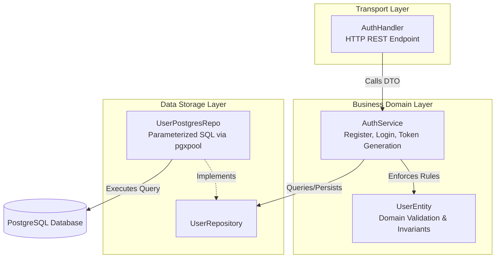

# 🌟 Golden Spec Example: User Authentication & Role Service

Contoh acuan standar (*Golden Example*) dokumen `02-technical-spec.md` dan `03-task-list.md` berstandar Senior Lead Engineer.

---

## Bagian 1: 02-technical-spec.md (Contoh Acuan)

```markdown
# 02-technical-spec.md: Layanan Otentikasi & Manajemen Pengguna

## 1. Audit Boilerplate & Modul Eksisting
Berdasarkan audit repositori pada modul `sandbox/auth-service`:
- **Router**: Go Chi `v5.0.12` (jangan mengimpor Gin atau Fiber).
- **Database Driver**: `jackc/pgx/v5` dengan `pgxpool`.
- **Shared Utilities Wajib Digunakan**:
  - `pkg/response/envelope.go`: Gunakan `response.JSON(w, http.StatusOK, data)` dan `response.Error(w, code, err)`. Dilarang menulis manual `json.NewEncoder(w).Encode(...)`.
  - `pkg/crypto/hasher.go`: Gunakan `crypto.HashBcrypt(pwd)` yang sudah dikonfigurasi dengan cost 12. Dilarang mengimpor library hashing baru.
  - `pkg/logger`: Gunakan `logger.FromContext(ctx)` untuk structured logging.
- **Konfigurasi Linter**: Kepatuhan terhadap `.golangci.yml` (errcheck, govet, staticcheck, revive).

---

## 2. Dekomposisi Arsitektur C4 Model (Component Level)



---

## 3. Architectural Decision Record (ADR-001)
- **Judul**: Penggunaan Stateless PASETO v4 Local daripada JWT HS256 untuk Access Token
- **Status**: ACCEPTED
- **Konteks**: Sistem membutuhkan token otentikasi yang kebal terhadap kerentanan cipher confusion (`alg: none`) yang sering menjangkiti implementasi JWT konvensional.
- **Keputusan**: Menggunakan PASETO v4 local (symmetric encryption via XChaCha20-Poly1305) dengan pustaka `aidarkhanov/nanoid` untuk session ID.
- **Konsekuensi Positif**: Bebas dari kerentanan algoritma JWT, payload otomatis terenkripsi penuh (data privacy terjamin).
- **Konsekuensi Negatif**: Ukuran token sedikit lebih besar dibandingkan JWT ringkas.

---

## 4. Definisi Interface & Data Contracts

```go
type UserRepository interface {
    Create(ctx context.Context, user *UserEntity) error
    FindByEmail(ctx context.Context, email string) (*UserEntity, error)
    UpdateLastLogin(ctx context.Context, userID string, loginAt time.Time) error
}

type AuthService interface {
    Register(ctx context.Context, req RegisterRequestDTO) (*AuthResponseDTO, error)
    Login(ctx context.Context, req LoginRequestDTO) (*AuthResponseDTO, error)
}
```

---

## 5. Security & Resilience Engineering
- **Context Timeout**: Seluruh pemanggilan repository wajib dibatasi timeout 3 detik menggunakan `context.WithTimeout(ctx, 3*time.Second)`.
- **Sanitasi Error**: Error internal database wajib di-log di server melalui `logger.Error(ctx, err)` dan hanya mengembalikan pesan domain `ErrInternalServerError` ke klien.
```

---

## Bagian 2: 03-task-list.md (Contoh Acuan)

```markdown
# 03-task-list.md: Rencana Eksekusi Bertahap (Vertical Slices)

### [ ] TASK-01: Domain Entity & Repository Database Layer
- **Tujuan**: Implementasi `UserEntity` dan `UserPostgresRepo` lengkap dengan parameterized SQL.
- **Berkas Target**:
  - `internal/domain/user.go`
  - `internal/repository/user_postgres.go`
  - `internal/repository/user_postgres_test.go`
- **Modul Eksisting Wajib**: `pkg/database/postgres.go`
- **Kriteria Pengujian (TDD-Ready)**:
  - Unit test `Create`: Valid user tersimpan tanpa error.
  - Boundary test `Create`: Duplicate email mengembalikan domain `ErrDuplicateEmail`.
  - Negative test `FindByEmail`: Email tidak terdaftar mengembalikan `ErrNotFound`.
  - Timeout test: Context dibatalkan sebelum query selesai mengembalikan `context.Canceled`.

---

### [ ] TASK-02: Auth Business Service & PASETO Token Generation
- **Tujuan**: Implementasi `AuthService` untuk logika pendaftaran dan login.
- **Berkas Target**:
  - `internal/service/auth.go`
  - `internal/service/auth_test.go`
- **Modul Eksisting Wajib**: `pkg/crypto/hasher.go`, `pkg/token/paseto.go`
- **Kriteria Pengujian**:
  - Unit test `Login`: Password benar menghasilkan access token valid.
  - Boundary test `Login`: Password salah mengembalikan `ErrInvalidCredentials`.
  - Assertion sharpness: Memeriksa isi claims (ID user, email, expiry) terverifikasi persis.
```
