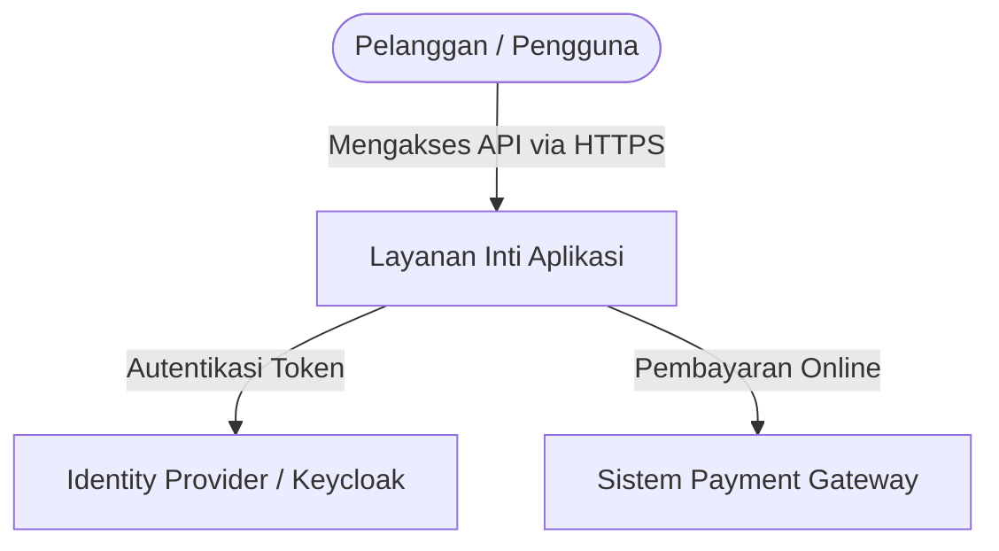
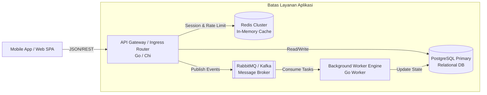
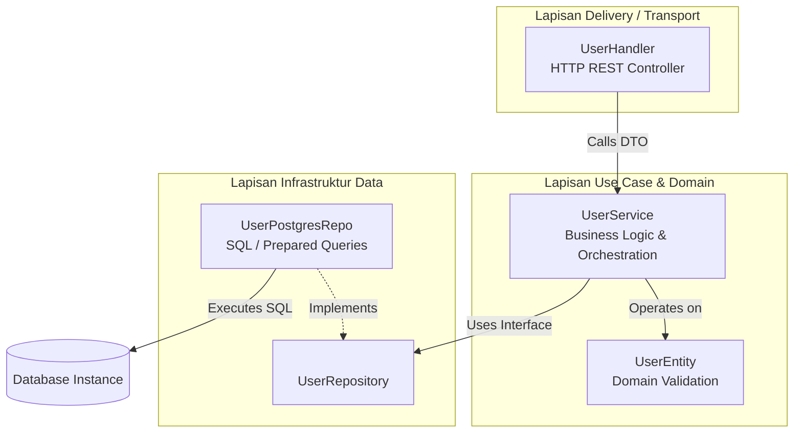

# 🏛️ Template & Panduan Architecture Decision Record (ADR) & C4 Model

Dokumen ini menjadi standar bagi Analis / Senior Tech Lead dalam mendokumentasikan keputusan arsitektur dan memetakan dekomposisi sistem menggunakan C4 Model di dalam berkas `02-technical-spec.md`.

---

## 1. Panduan Dekomposisi C4 Model

Setiap spesifikasi teknis (`02-technical-spec.md`) wajib menyajikan visualisasi arsitektur berlapis menggunakan sintaks Mermaid:

### Level 1: System Context Diagram
Menjelaskan sistem perangkat lunak dalam hubungannya dengan pengguna manusia dan sistem eksternal lain.



### Level 2: Container Diagram
Menjelaskan aplikasi tingkat tinggi, penyimpanan data, antrian pesan, dan teknologi yang digunakan.



### Level 3: Component Diagram (Wajib untuk Fitur Baru)
Menjelaskan komponen internal modul atau fitur yang sedang dirancang, memperlihatkan pemisahan lapisan (Clean Architecture).



---

## 2. Format Baku Architectural Decision Record (ADR)

Setiap keputusan desain yang memiliki dampak terhadap trade-off performa, keamanan, penyimpanan, atau penambahan dependensi **WAJIB** dicatat dalam format ADR berikut:

```markdown
### ADR-[Nomor]: [Judul Keputusan yang Deskriptif dan Ringkas]
- **Status**: PROPOSED | ACCEPTED | DEPRECATED | SUPERSEDED
- **Tanggal**: YYYY-MM-DD
- **Pengambil Keputusan**: Analis (Tech Lead)
- **Konsultasi**: Pengguna / PM

#### 1. Konteks & Permasalahan (Context)
Jelaskan latar belakang teknis atau tantangan bisnis yang dihadapi.
- Mengapa keputusan ini perlu diambil?
- Apa kendala atau batasan yang ada (latency, memory budget, SLA, skalabilitas)?

#### 2. Keputusan yang Diambil (Decision)
Jelaskan secara presisi solusi atau teknologi yang dipilih.
- *"Kami memutuskan untuk menggunakan [Pilihan X] daripada [Pilihan Y]."*
- Bagaimana implementasinya akan dilakukan secara teknis?

#### 3. Analisis Alternatif yang Dipertimbangkan (Alternatives Considered)
| Opsi Alternatif | Kelebihan | Kelemahan / Alasan Ditolak |
| :--- | :--- | :--- |
| Opsi A (Pilihan terpilih) | Cepat, native standard library, zero external dependency | Memerlukan sedikit boilerplate kode manual |
| Opsi B | Sintaks sangat ringkas | Menambah beban dependency 15MB, lisensi tidak jelas |

#### 4. Dampak & Konsekuensi (Consequences)
- **Konsekuensi Positif**:
  - Peningkatan performa response time ~30%.
  - Zero external dependencies di `go.mod`.
- **Konsekuensi Negatif / Trade-off**:
  - Pengembang harus menulis migration script manual.
- **Strategi Mitigasi Risiko**:
  - Penambahan unit test boundary dan query optimization plan.

#### 5. Kepatuhan & Checklist Implementasi (Compliance Check)
- [ ] Implementasi Coder wajib mengikuti kontrak interface yang ditetapkan di ADR ini.
- [ ] Pengujian konkurensi wajib disertakan untuk memverifikasi asumsi performa.
```
