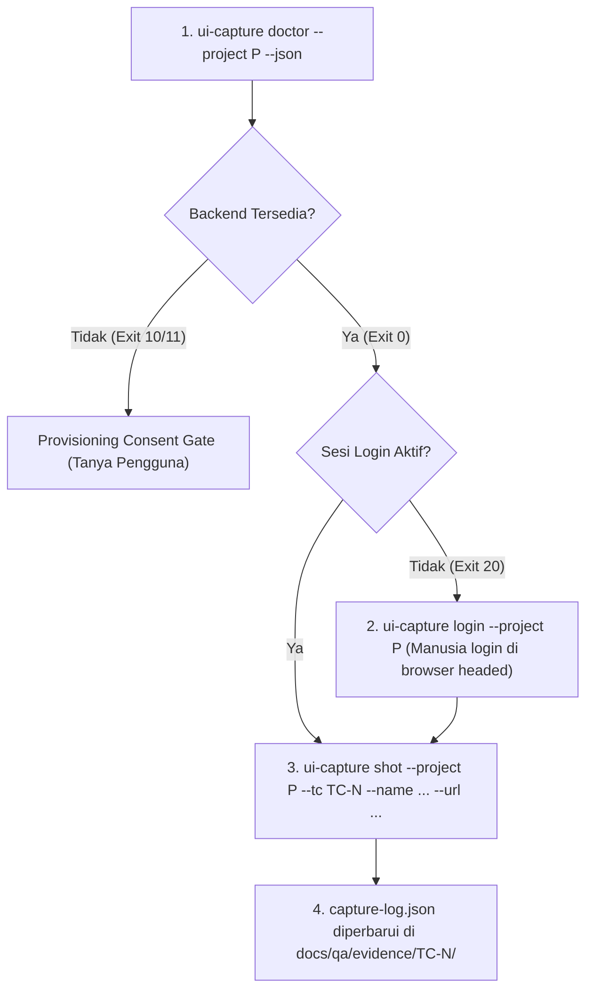

# UI Evidence Capture Protocol & Tooling (`ui-capture`)

Protokol penangkapan bukti visual antarmuka pengguna (UI Screenshots) untuk pengujian QA, validasi runtime, dan audit kepatuhan tanpa risiko mutasi data liar atau kebocoran kredensial.

---

## 1. Kapan Menggunakan Skill Ini?

Skill ini digunakan oleh **QA Engineer** dan **Analis / Senior Tech Lead** saat:
1. Menjalankan pengujian Fase 1 (Manual Verification) pada skenario yang memiliki antarmuka pengguna (Web UI, portal admin, dashboard API Gateway).
2. Menghasilkan bukti visual bagi Test Case berlabel `HUMAN_VALIDATION_REQUIRED` yang membutuhkan konfirmasi visual manusia (misalnya verifikasi katalog API di portal UI).
3. Melakukan audit integritas bukti tangkapan layar di folder `docs/qa/evidence/TC-*`.

> [!IMPORTANT]
> Screenshot pada **Fase 1** berfungsi murni sebagai **alat bantu pengumpulan bukti (read-only)**, **BUKAN** suite pengujian otomasi end-to-end. Pembuatan automation test suite tetap tunduk pada aturan Fase 2 (wajib persetujuan & rujukan manusia).

---

## 2. Alur Kerja Standar (Workflow Lifecycle)



1. **Langkah 1: Periksa Kapabilitas**:
   Jalankan `ui-capture doctor --project <project_id> --json`.
2. **Langkah 2: Selesaikan Consent Gate (Bila Belum Terpasang)**:
   Jika mengembalikan kode `10` atau `11`, tampilkan pertanyaan baku ke pengguna. Jangan pernah menginstal backend tanpa persetujuan eksplisit.
3. **Langkah 3: Login Sesi Manusia (Bila Dibutuhkan)**:
   Jalankan `ui-capture login --project <project_id>`. Browser visual akan terbuka agar pengguna dapat login dengan aman.
4. **Langkah 4: Ambil Tangkapan Layar Read-Only**:
   Jalankan `ui-capture shot --project <project_id> --tc TC-<N> --name <nama_skenario> --url <target_url>`.
5. **Langkah 5: Hapus Sesi (Opsional / Setelah Selesai)**:
   Jalankan `ui-capture logout --project <project_id>` jika sesi tidak lagi dibutuhkan.

---

## 3. Tabel Exit Code Baku & Reaksi Agen

Agen wajib menangani exit code dari CLI `ui-capture` secara deterministik sesuai tabel berikut:

| Exit Code | Nama Status | Tindakan Wajib Agen |
|---|---|---|
| **0** | `OK` | Operasi sukses. Lanjutkan ke langkah pengujian berikutnya. |
| **3** | `NEEDS_HUMAN_URL_CONFIRMATION` | Target UI di `qa-targets.yaml` belum terkonfirmasi atau `base_url` kosong. **HARD STOP**: Jangan menebak URL, minta konfirmasi URL ke pengguna di Control Room. |
| **4** | `INVALID_UI_TARGET_PAGE` | Halaman yang dimuat bukan antarmuka sah (terdeteksi `Object Not Found`, `404 Not Found`, dsb., atau error dalam section). File disimpan sebagai `REJECTED-ERROR-PAGE-<name>.png` dan dicatat sebagai `REJECTED_ERROR_PAGE` / `REJECTED_ERROR_IN_SECTION`. |
| **5** | `SECTION_VALIDATION_FAILED` | Bagian spesifik yang ditargetkan tidak tampak di layar, berukuran 0px, atau teks ekspektasi tidak cocok (`REJECTED_SECTION_*`). File disimpan sebagai `REJECTED-SECTION-<status>-<name>.png`. |
| **10** | `CONSENT_REQUIRED` | Tampilkan **Provisioning Consent Gate** ke pengguna di Control Room. Jangan jalankan instalasi otomatis. |
| **11** | `NO_BACKEND` | Tidak ada backend terpasang. Tampilkan opsi Consent Gate. Jika pengguna menolak, gunakan fallback `manual`. |
| **20** | `AUTH_REQUIRED` | Sesi autentikasi belum ada, kedaluwarsa, atau redirect ke halaman login. Minta pengguna menjalankan `ui-capture login --project <project_id>`. |
| **21** | `HUMAN_CHALLENGE` | Terdeteksi CAPTCHA / Cloudflare Turnstile / MFA / verifikasi manusia. **BERHENTI SEGERA (HARD STOP)**. Laporkan ke manusia. **Dilarang keras mencoba menyelesaikan atau melewati gate ini.** |
| **30** | `ORIGIN_NOT_ALLOWED` | URL target berada di luar `allowed_origins` pada konfigurasi. Batalkan screenshot, laporkan pelanggaran konfigurasi. |
| **31** | `READ_ONLY_VIOLATION` | Halaman web mencoba request mutasi (`POST/PUT/PATCH/DELETE`) yang diblokir oleh guard read-only. Tangkapan layar tetap disimpan jika halaman selesai render, namun catat jumlah pemblokiran. |
| **40** | `INVALID_ARGS` | Argumen tidak valid (misal path traversal pada parameter `--tc` atau `--name`). Perbaiki parameter CLI. |
| **50** | `BACKEND_ERROR` | Kesalahan teknis pada runtime backend. Laporkan ringkasan pesan error (tanpa data sensitif) dan tawarkan panduan manual. |

---

## 4. Larangan Mutlak (Absolute Invariants)

> [!CAUTION]
> Pelanggaran terhadap larangan berikut akan memicu pemblokiran otomatis oleh sistem tata kelola agen:

1. **Dilarang Menyelesaikan CAPTCHA / Bot Challenges**:
   Jika menemui CAPTCHA, hCaptcha, Turnstile, reCAPTCHA, atau teks "verify you are human", agen **DILARANG KERAS** mencoba mengklik checkbox, menyelesaikan puzzle, atau melakukan bypass.
2. **Dilarang Melakukan Mutasi Data Melalui UI**:
   Saat mengambil screenshot (`shot`), agen dilarang mengeklik tombol Submit, Simpan, Tambah, Edit, Hapus, atau memicu mutasi status database.
3. **Dilarang Membaca atau Membocorkan Kredensial**:
   Agen tidak boleh menampilkan atau mencatat password, token autentikasi, session storage, atau cookie ke terminal log atau laporan QA.
4. **Dilarang Menginstal Backend Diam-Diam**:
   Setiap eksekusi `setup --backend ... --yes` hanya boleh dijalankan setelah pengguna memilih opsi instalasi secara tertulis.

---

## 5. Contoh Perintah CLI (`ui-capture`)

```bash
# 1. Inisialisasi konfigurasi project
ui-capture init --project sample-app --origin https://portal.example.internal --login-url https://portal.example.internal/admin/

# 2. Diagnostik kapabilitas sistem (Read-only, tanpa instal)
ui-capture doctor --project sample-app --json

# 3. Setup backend (HANYA setelah persetujuan manusia)
ui-capture setup --backend playwright-python --yes

# 4. Validasi Target URL & Anti-Guessing Gate
ui-capture targets --project sample-app

# 5. Login sesi manusia
ui-capture login --project sample-app

# 6. Tangkap screenshot read-only dengan Layer 1 Deteksi Halaman Error
ui-capture shot --project sample-app \
  --tc TC-15 \
  --name 01-api-catalog-view \
  --target-name admin_web_portal \
  --expect-text "API Gateway" \
  --full-page \
  --mask "input[type=password]"

# 7. Tangkap screenshot bagian tertentu (Highlight bingkai merah)
ui-capture shot --project sample-app \
  --tc TC-15 \
  --name 02-resources-table-highlight \
  --url "https://portal.example.com/apis" \
  --section "#resources-table" \
  --section-mode highlight \
  --expect-section-text "GET /v1/inquiry"

# 8. Tangkap screenshot bagian tertentu (Crop fokus komponen)
ui-capture shot --project sample-app \
  --tc TC-15 \
  --name 03-status-card-cropped \
  --url "https://portal.example.com/apis" \
  --section-text "Status Layanan" \
  --section-mode crop \
  --expect-section-text "Active"

# 9. Status sesi
ui-capture status --project sample-app

# 10. Logout sesi
ui-capture logout --project sample-app
```
