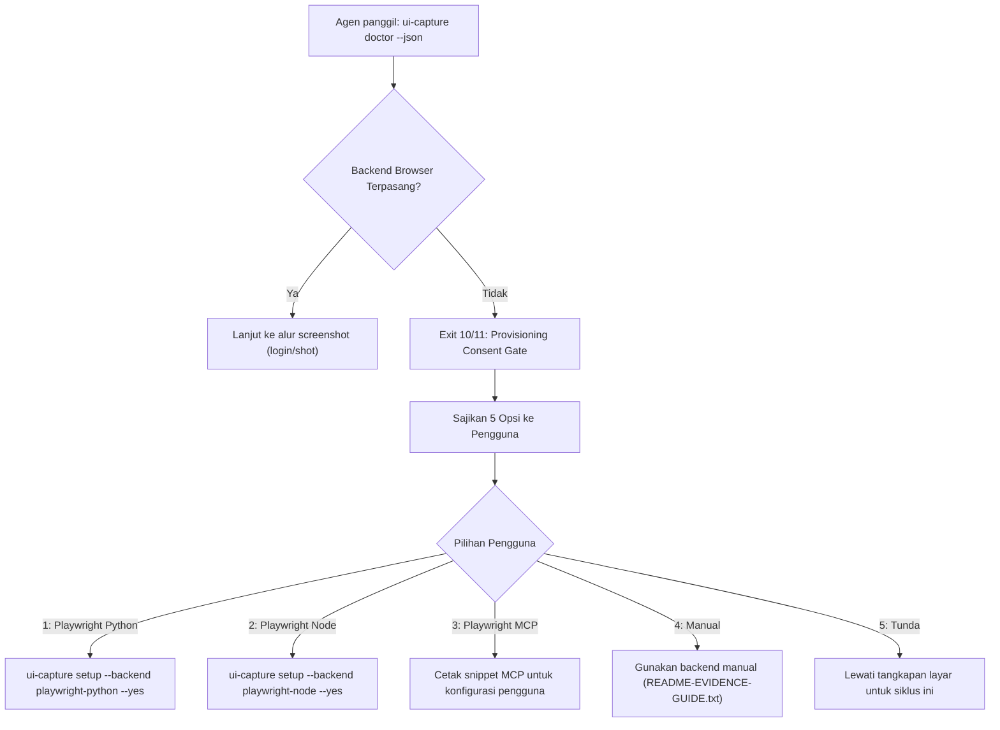

# Provisioning Consent Gate Protocol (Zero Unconsented Installations)

Dokumen ini mendefinisikan protokol **Provisioning Consent Gate** yang mengatur penyediaan dependensi browser secara beretika, transparan, dan berada di bawah kendali penuh manusia (*Human Sovereignty*).

---

## 1. Latar Belakang & Prinsip Utama (Keputusan D2 & D3)

1. **Framework Murni Terbuka (Public & Zero External Dependencies)**:
   - CLI orchestrator `ui-capture` ditulis murni menggunakan Python Standard Library (`python3 -I`).
   - Tidak ada ketergantungan wajib pada package manapun untuk fungsi dasar (`doctor`, `init`, `status`, `logout`, dan rencana `setup`).
2. **Dilarang Menginstal Diam-Diam (Zero Silent Installation)**:
   - Agen dilarang keras menginstal pustaka eksternal (Playwright, Puppeteer, Selenium, Chromium, dsb.) secara sepihak.
   - Jika kebutuhan screenshot belum terpasang, agen **wajib berhenti**, menyajikan opsi secara transparan, dan meminta persetujuan manusia.

---

## 2. Alur Kerja Gate



---

## 3. Teks Pertanyaan Baku ke Pengguna

Saat `doctor` mengembalikan exit code `10` atau `11`, agen wajib menampilkan teks baku berikut kepada pengguna:

> **Kebutuhan screenshot UI belum terpasang.** Pilih salah satu:
> 1. **(Rekomendasi) Playwright Python** — instal ke tool dir terisolasi `~/.gemini/tools/ui-capture/venv` + Chromium (~150–200 MB). Tidak mengubah dependensi project.
> 2. **Playwright Node** — instal ke `~/.gemini/tools/ui-capture/node` + Chromium (~150–200 MB).
> 3. **Playwright MCP** — tanpa instal oleh agent; saya berikan snippet konfigurasi MCP untuk Anda pasang sendiri.
> 4. **Manual** — tanpa instalasi; saya buatkan panduan screenshot di folder evidence untuk Anda isi.
> 5. **Tunda** — lewati screenshot untuk siklus ini.

---

## 4. Spesifikasi Perintah Instalasi Terisolasi

Bila dan hanya bila pengguna memilih opsi 1 atau 2 dan menyetujuinya secara eksplisit:

- **Playwright Python**:
  ```bash
  python3 -m venv ~/.gemini/tools/ui-capture/venv
  ~/.gemini/tools/ui-capture/venv/bin/pip install playwright
  ~/.gemini/tools/ui-capture/venv/bin/python -m playwright install chromium
  ```
- **Playwright Node**:
  ```bash
  npm --prefix ~/.gemini/tools/ui-capture/node i playwright
  npx --prefix ~/.gemini/tools/ui-capture/node playwright install chromium
  ```

### Isolasi Direktori:
- Seluruh instalasi bertempat di `~/.gemini/tools/ui-capture/`.
- Tidak ada file dependensi project (`go.mod`, `package.json`, `requirements.txt`) yang disentuh.
- Python global dan Node global sistem operasi tetap bersih.

---

## 5. Pencatatan Audit Trail

Setiap kali keputusan diambil di Gate ini, catat peristiwa tersebut ke log audit:
```bash
team-orch log <project_id> --role qa-engineer --event "UI_CAPTURE_PROVISIONING_DECISION" --desc "Keputusan pengguna: <pilihan_terpilih>"
```
Serta simpan preferensi ke `qa-ui.config.json` pada field `"backend_preference"`.
